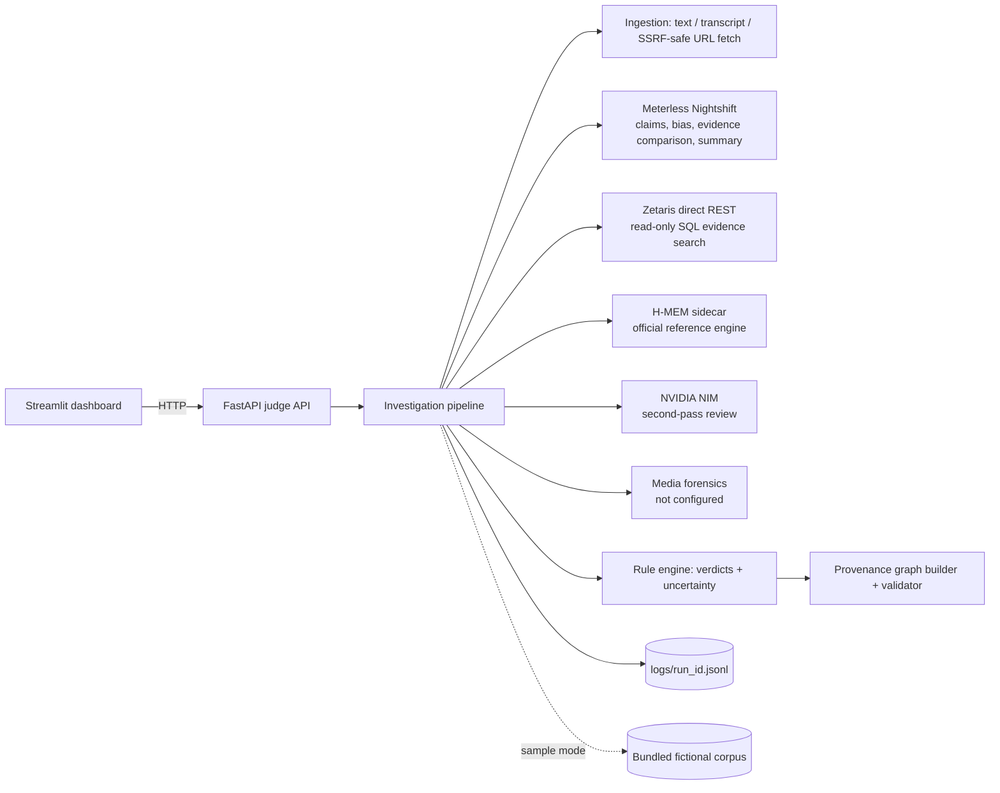

# VERITAS — Cognitive Bias & Deepfake Forensic Suite

## 1. Overview

VERITAS investigates a piece of content: a text, a transcript, or a public URL. It returns:

- the claims the content makes;
- the persuasion techniques used, anchored to exact text spans;
- evidence for and against each claim;
- an evidence-derived verdict with uncertainty for each claim;
- a provenance graph that links every conclusion back to its source excerpts.

The stack is FastAPI, Pydantic, HTTPX, a Streamlit dashboard, pytest, JSONL logging, and Docker.

Sections 5–9 name every pre-existing component, explain the Zetaris and Meterless integrations, say where NVIDIA sits, and note how Cursor was used to build this repository. None of those tools are called at runtime except the sponsor services configured in `.env`.

## 2. The problem

Misleading content usually mixes true facts with unsupported causal leaps, urgency, and vague authority. A
one-word verdict does not help a reader see which part is wrong. VERITAS shows its work: every edge in the graph
carries a written basis.

## 3. What makes VERITAS different

- **Provenance graph.** The graph has typed nodes: input, text span, claim, evidence source, excerpt, analysis
  finding, media detector result, hypothesis, conclusion, and recommendation. Its typed edges are `contains`,
  `derived_from`, `supports`, `contradicts`, `contextualizes`, `evaluates`, `indicates_possible_manipulation`, and
  `leads_to`. Edges without a basis are rejected by the schema.
- **Rule-derived verdicts.** Models classify how each excerpt relates to a claim. The verdict itself is computed
  deterministically from those cited relationships, so it can always be traced.
- **Anchored model output.** Claims and bias findings from a model are kept only if their quoted text is found
  in the input.
- **Honest degradation.** Every stage reports `completed`, `failed`, `skipped`, `not_configured`, or
  `disabled_sample_mode`. Fallbacks are named in the response and the log.

## 4. Architecture



The code is laid out as follows:

- `app/main.py`: the API.
- `app/pipeline.py`: orchestration.
- `app/services/`: one adapter per provider, plus the deterministic analyzers.
- `engines/hmem/`: the vendored H-MEM reference engine, unmodified (Apache-2.0).
- `engines/hmem-sidecar/`: its HTTP shim.

## 5. Pre-existing components

VERITAS was written new in this repository. Nothing under `veritas/` existed before this project. These pieces were
brought in rather than written here:

| Component | Origin | What VERITAS did with it |
| --- | --- | --- |
| H-MEM reference engine | [Meterless/Meterless](https://github.com/Meterless/Meterless) `engines/hmem` at commit `1742dec56a66e58eef9dda2d2b865823758ca8cd`, Apache-2.0 (`engines/hmem/LICENSE`) | Copied unmodified: `reference/`, `conformance/`, `AGENTS.md`, `LICENSE`. No memory logic was rewritten. |
| H-MEM conformance suite | Same repository and commit | Run as published. Result: 13/13 checks passed. |
| Zetaris SQL REST contract | Official Zetaris getting-started helper `scripts/zetaris_sql.py` (`RestChannel`) | Not vendored. `app/services/zetaris.py` speaks that HTTP contract. |
| Nightshift local runtime | Meterless Nightshift OpenAI-compatible API | Not vendored. `app/services/nightshift.py` is a client of a runtime the operator starts. |
| NVIDIA NIM chat API | `https://integrate.api.nvidia.com/v1/chat/completions` | Not vendored. `app/services/nvidia_review.py` is a client. |
| FastAPI, Starlette, Pydantic, HTTPX, Uvicorn, Streamlit, pytest, Node, tsx | Their own upstream packages, pinned in `requirements.txt`, `requirements-dev.txt`, `requirements-ui.txt`, and `engines/hmem-sidecar/package.json` | Used as libraries. |

Written for VERITAS: the API, pipeline, provider adapters, SSRF-safe fetcher, rule engine, provenance graph, sample
corpus, Streamlit dashboard, H-MEM HTTP sidecar (`engines/hmem-sidecar/server.ts`), tests, and Docker files. The
sidecar only transports calls into the unmodified `HMEM` class.

The H-MEM reference documents its own limits. Its embedder is a deterministic hash, and storage is a JSON file.
Relevance scores are that engine's scores, not production semantic similarity.

## 6. How Zetaris is integrated

Zetaris is the evidence store. VERITAS does not embed a Zetaris client library. `app/services/zetaris.py` calls the
direct REST channel:

- `POST {ZETARIS_REST_URL}/sql-editor/sqls/run`
- Headers: `Authorization: Bearer $ZETARIS_API_KEY`, `X-Org-ID: $ZETARIS_ORG_ID`, `X-Request-ID` (a new UUID), `Content-Type: application/json`
- Body: `{"queryId": "<uuid>", "sql": "<one statement>", "source": "SqlEditor", "limit": N}`
- Rows are read from the JSON field `data`, in the column order of the `SELECT`

Each investigation issues one or more read-only searches against `ZETARIS_EVIDENCE_TABLE` (see `docs/zetaris_setup.md`
for the column list). Search words are lowercase alphanumeric tokens matched to `^[a-z0-9]{3,30}$`. User sentences
are not concatenated into SQL. The table name must be a plain identifier such as `veritas.evidence_sources`.

The trace records the query id, path, table, limit, row count, and duration. A failed or unconfigured Zetaris call
is reported on the `evidence_retrieval` agent. The run continues as `partial` and does not invent sources. Sample
mode does not call Zetaris. It uses `app/sample_data/sample_sources.json`, and every record is marked fictional.

Creating and loading the table is a write, so VERITAS does not do it. The operator registers the table.

**Verification.** Request shape, SQL allow-listing, HTTP 401 handling, retries, and the iteration cap are covered
by pytest with stand-in HTTP responses in `tests/fakes.py`. Those stand-ins are test-only. **No live Zetaris query
was run in this environment, because no API key or org id was available.** Do not treat the sample corpus as
Zetaris output.

## 7. How Meterless is integrated

Meterless is used twice, for two different jobs. Neither path is a renamed database call.

### Nightshift, the reasoning model

`app/services/nightshift.py` talks to a local Nightshift runtime:

- Base URL `METERLESS_BASE_URL` (default in `.env.example`: `http://127.0.0.1:8088/v1`)
- `Authorization: Bearer $METERLESS_RUNTIME_TOKEN` (the `rt-local` placeholder is not a token)
- `meterless-app: veritas` on every request, and `meterless-scope: user` on chat requests
- `POST /chat/completions` with `"stream": false` and the configured routing mode (`METERLESS_MODEL`, default `meterless/auto`)
- Readiness is `GET /v1/models`: HTTP 401/403 means unauthorized, HTTP 200 with `meterless/` model ids means online

Nightshift is asked to extract claims, mark persuasion techniques, classify each excerpt against its claim, suggest
further search words, and write a short summary. Analyzed text is wrapped in untrusted-content markers. The system
prompt tells the model not to follow instructions found in that text. A claim or bias finding is kept only when its
quote occurs in the source. The model id written to the log is the `model` field of the provider response, not the
requested routing mode.

If Nightshift is unset, times out, or returns nothing usable, the stage status is `not_configured` or `failed` and
the pipeline says it fell back to `local_heuristic_extractor` or `local_pattern_detector`. It does not call another
provider and label the result Nightshift.

**Verification.** Header shape, anchored-quote filtering, timeout fallback, and model logging are tested with
stand-ins. **No live Nightshift call was run here, because no runtime was available.**

### H-MEM, investigative memory

The official reference engine is the pre-existing component in section 5. VERITAS added only
`engines/hmem-sidecar/server.ts`, a Node HTTP process that constructs `HMEM` with a `persistDir` and exposes:

| Method | Path | Engine call |
| --- | --- | --- |
| GET | `/health` | record and ledger counts |
| POST | `/v1/memories` | `add` (a `source` is required, matching the engine) |
| POST | `/v1/query` | `query` |
| POST | `/v1/feedback` | `feedback` |
| GET | `/v1/ledger` | ledger history |

`app/services/meterless_engine.py` is the Python client (`HMEM_URL`). Before evidence retrieval it recalls memories
for the question. The report labels them "Remembered finding. Not evidence for this case until its sources are
rechecked." They do not change verdicts. After assessment, supported, contradicted, and mixed conclusions are
stored with provenance refs pointing at the evidence ids. The recall threshold defaults to `0.2`
(`HMEM_RECALL_THRESHOLD`) because this reference embedder scores below the engine's own 0.35 default on short claims.

**Verification.** `npm run conformance` in `engines/hmem-sidecar` passed 13/13 against the vendored engine.
`python scripts/verify_hmem.py` stored a memory in a running sidecar and a later investigation recalled it through
the API. That is a real engine call, not a test double.

## 8. Where NVIDIA contributes

NVIDIA is a second reviewer, not the analyst. Nightshift (or the labeled local fallback) produces the claim
relationships. The rule engine in `app/services/assessment.py` turns those relationships into a verdict. Only then
does `app/services/nvidia_review.py` call NVIDIA NIM:

- `POST {NVIDIA_BASE_URL}/chat/completions` (default `https://integrate.api.nvidia.com/v1/chat/completions`)
- `Authorization: Bearer $NVIDIA_API_KEY`
- `"stream": false`, because NIM streams unless this is set
- Default model `nvidia/llama-3.3-nemotron-super-49b-v1.5` (`NVIDIA_MODEL`)

The reviewer receives the claims, excerpts, and verdicts and returns concerns. If it suggests a different verdict,
VERITAS keeps the original verdict, raises uncertainty one step, records the disagreement in the report and in the
JSONL trace, and attributes the note to `nvidia:<model id from the response>`. NVIDIA is skipped when
`NVIDIA_API_KEY` is empty or the request option turns the review off. A failed call is `failed` on the
`nvidia_review` agent. The rest of the report still returns.

NVIDIA does not extract claims, query Zetaris, write H-MEM, or score media. No media detector is configured, so
VERITAS never emits an NVIDIA or other manipulation score.

**Verification.** Request shape and the "disagree but do not overwrite" behavior are tested with stand-ins.
**No live NVIDIA call was run here, because no API key was available.**

## 9. How Cursor was used

Cursor was the development environment.

Concretely, Cursor was used to:

- read the Meterless H-MEM reference and the Zetaris REST example, then vendor the engine without modifying it;
- generate and edit the Python API, adapters, sample corpus, Streamlit dashboard, Docker files, and pytest suite;
- run pytest (88 passed), the H-MEM conformance suite (13/13), `scripts/verify_hmem.py` against a local sidecar,
  and a sample-mode API smoke test;
- open the Streamlit dashboard in a browser and correct the provenance-graph rendering.

Cursor is not a runtime dependency. A deployed VERITAS process does not call Cursor, and Cursor was not used as a
stand-in for Zetaris, Nightshift, H-MEM, or NVIDIA.

## 10. Sponsor status at a glance

| Integration | Role | Verified here |
| --- | --- | --- |
| Zetaris | Evidence SQL over the official REST channel | Request shape and failures, with test doubles only. No live query. |
| Meterless Nightshift | Claims, bias, evidence comparison, summary | Request shape, anchoring, and fallback, with test doubles only. No live call. |
| Meterless H-MEM | Recall and store, via the official engine | Conformance 13/13 and a live store/recall/ledger cycle. |
| NVIDIA NIM | Second-pass review only | Disagreement handling, with test doubles only. No live call. |
| Media detector | — | Not implemented. Media is reported as not analyzed. |

The test doubles live only in `tests/fakes.py`. When a service is missing, the stage reports `not_configured` and
uses an explicitly labeled local heuristic, or it retrieves no evidence.

## 11. Quick start (local, sample mode)

```powershell
cd veritas
python -m venv .venv
.\.venv\Scripts\python -m pip install -r requirements-dev.txt
$env:SAMPLE_MODE="true"; .\.venv\Scripts\python run.py
# open http://localhost:8000/docs
```

On macOS or Linux, use `source .venv/bin/activate` and `SAMPLE_MODE=true python run.py`.

## 12. Docker

```bash
docker build -t veritas .
docker run --rm -p 8000:8000 --env-file .env -e SAMPLE_MODE=true veritas
```

The image build has not been run yet. The development machine had no working Docker engine because WSL is not
installed. The Dockerfile contract is checked by `tests/test_docker_config.py`, and the same `run.py` entry point
was run directly.

- The image is based on `python:3.11-slim`, runs as a non-root user, needs no GPU, and listens on port 8000.
- `.env` is excluded by `.dockerignore`. Pass secrets at runtime with `--env-file` only.
- Without a `.env` file, use `docker run --rm -p 8000:8000 -e SAMPLE_MODE=true veritas`. Sample mode needs no
  network access.

**Reaching services on the host from a container.** Use `host.docker.internal` instead of `localhost`, for example
`METERLESS_BASE_URL=http://host.docker.internal:8088/v1`. On Linux, add `--add-host=host.docker.internal:host-gateway`.

**Full stack.** `docker compose up --build` starts the API, the H-MEM sidecar (`HMEM_URL=http://hmem:8787`), and the
dashboard on port 8501.

## 13. Configuration

All settings are environment variables. `run.py` and the dashboard read `.env` from the project root and apply those values at startup, so a local demo follows the file. See `.env.example` for the full list with placeholders. The main ones are:

| Variable | Default | Purpose |
| --- | --- | --- |
| `SAMPLE_MODE` | `false` | Offline demonstration with bundled fictional data |
| `PORT` | `8000` | API port (binds `0.0.0.0`) |
| `INVESTIGATION_BUDGET_SECONDS` | `420` | Overall time budget; hard ceiling 900 |
| `MAX_REASONING_ITERATIONS` | `3` | Evidence-retrieval rounds; hard ceiling 5 |
| `PROVIDER_RETRY_ATTEMPTS` | `2` | Retries per provider call (backoff + jitter) |
| `METERLESS_BASE_URL`, `METERLESS_RUNTIME_TOKEN`, `METERLESS_MODEL` | — | Nightshift |
| `ZETARIS_REST_URL`, `ZETARIS_API_KEY`, `ZETARIS_ORG_ID`, `ZETARIS_EVIDENCE_TABLE` | — | Zetaris (see `docs/zetaris_setup.md`) |
| `HMEM_URL`, `HMEM_SIDECAR_TOKEN`, `HMEM_RECALL_THRESHOLD` | — / — / `0.2` | H-MEM sidecar |
| `NVIDIA_API_KEY`, `NVIDIA_MODEL` | — / `nvidia/llama-3.3-nemotron-super-49b-v1.5` | NVIDIA review |

Each provider has its own timeout: Zetaris 45 s, Nightshift 60 s, H-MEM 45 s, NVIDIA 45 s. All are configurable.

## 14. API reference

Swagger UI is served at `/docs` and the OpenAPI spec at `/openapi.json`.

| Method | Path | Purpose |
| --- | --- | --- |
| GET | `/health` | Liveness plus which integrations are configured (no network calls) |
| GET | `/` | Landing page |
| POST | `/api/v1/investigate` | Run an investigation |
| GET | `/api/v1/runs/{run_id}` | Fetch a stored result |
| GET | `/api/v1/runs/{run_id}/report.md` | 12-section Markdown report |
| DELETE | `/api/v1/runs/{run_id}` | Delete a stored result |
| GET | `/api/v1/integrations/status` | Live probes of configured sponsors (disabled in sample mode) |

Request body:

```json
{
  "run_id": "optional-id",
  "input": {"query": "required", "content": "optional text", "transcript": "optional", "url": "optional", "media_url": "optional"},
  "options": {"sample_mode": null, "include_provenance": true, "include_media_analysis": false, "include_nvidia_review": true, "use_memory": true}
}
```

The response is `{status, run_id, output, agents, trace_id, log_file, execution_time_seconds}`:

- `status` is `success`, `partial`, or `error`.
- `output` contains `summary`, `overall_assessment`, `claims`, `bias_indicators`, `evidence`, `assessments`,
  `memory`, `review`, `media`, `provenance{nodes,edges}`, `unresolved_questions`, `next_steps`, and `limitations`.

Every error has the same shape and never includes stack traces or secrets:

```json
{"status": "error", "run_id": null, "error": {"code": "validation_error", "message": "...", "retryable": false, "details": []}, "trace_id": "..."}
```

| HTTP status | Error codes |
| --- | --- |
| 400 | `invalid_run_id` |
| 404 | `run_not_found`, `not_found` |
| 409 | `run_id_conflict` |
| 413 | `payload_too_large` |
| 422 | `validation_error` |
| 500 | `internal_error`, `investigation_failed` |

## 15. curl examples

```bash
curl http://localhost:8000/health

curl -X POST http://localhost:8000/api/v1/investigate -H "Content-Type: application/json" \
  -d '{"run_id":"demo-1","input":{"query":"Is the plant destroying the harbor?"},"options":{"sample_mode":true}}'

curl -X POST http://localhost:8000/api/v1/investigate -H "Content-Type: application/json" \
  -d '{"input":{"query":"Check this post","content":"Experts say the new tax is a DISASTER. Either we repeal it or the economy collapses."},"options":{"sample_mode":true}}'

curl http://localhost:8000/api/v1/runs/demo-1
curl http://localhost:8000/api/v1/runs/demo-1/report.md
```

In PowerShell, use `curl.exe` and put the JSON in a file: `--data-binary "@req.json"`.

## 16. Investigation workflow

1. **Ingest** the text, transcript, and/or URL. URLs are fetched SSRF-safe as HTML or plain text only. Content is
   capped at `MAX_CONTENT_CHARS`.
2. **Extract claims** with Nightshift. Each claim gets an id, type, verifiability, span, and initial uncertainty.
   If Nightshift is unavailable, a labeled local heuristic is used instead.
3. **Detect bias indicators** for nine techniques, each with an explanation and a span. A neutral result is
   allowed and reported.
4. **Recall memory** from H-MEM. Recalled items are shown as remembered context, never counted as evidence.
5. **Retrieve evidence** from Zetaris in up to `MAX_REASONING_ITERATIONS` rounds. Later rounds use
   Nightshift-refined keywords for claims that are still uncovered.
6. **Compare evidence** with Nightshift. Each excerpt is classified per claim as `supports`, `contradicts`,
   `contextualizes`, or `does_not_establish`, with a one-sentence basis.
7. **Assess** each claim with the rule engine, which produces the verdict and uncertainty.
8. **Review** with NVIDIA. Its findings are recorded. If it disagrees, the verdict stays the same, the uncertainty
   rises one level, and the disagreement is logged.
9. **Store** supported, contradicted, and mixed conclusions in H-MEM, with their evidence ids as provenance refs.
10. **Media**: no detector is configured, so media is reported as `not_configured`.
11. **Synthesize** the report and build and validate the provenance graph.

## 17. Provenance graph

Every node is connected to the input node, and every verdict links to the excerpts that produced it. The validator
rejects duplicate node ids, edges that reference missing nodes, and edges without a basis. The dashboard renders
the graph and lists each edge with its basis.

## 18. Report format and verdicts

Verdict labels:

- `supported`: at least one supporting excerpt and none contradicting.
- `contradicted`: the reverse.
- `mixed_evidence`: both supporting and contradicting excerpts.
- `insufficient_evidence`: sources only add context, or do not establish the claim.
- `unverified`: no evidence was found, or the statement is an opinion, prediction, or call to action.

Uncertainty is qualitative: `low`, `moderate`, `high`, or `very_high`. It comes from evidence quality: how many
independent sources there are, and whether any is a primary source. No numeric confidence is invented.

`GET /api/v1/runs/{id}/report.md` renders 12 sections:

1. Executive summary
2. Overall assessment
3. Claims
4. Bias indicators
5. Evidence
6. Claim-by-claim reasoning
7. Remembered context
8. Independent review
9. Media
10. Provenance
11. Unresolved questions and next steps
12. Limitations

## 19. Dashboard

```bash
pip install -r requirements-ui.txt
VERITAS_API_URL=http://localhost:8000 streamlit run app/ui/dashboard.py
```

The dashboard is a separate Streamlit process. It uses a dark background and red section titles. The investigation
form is on the Dashboard page. Below a completed run, that page shows the lead claim, persuasion techniques,
media status, an evidence map (supporting sources, conclusion, contradictory sources), and a qualitative
uncertainty bar with next steps. Other pages list claims with the
excerpts beside them, evidence, bias spans, the provenance graph, and the report. API-provided text is
HTML-escaped. Media is shown as not analyzed unless a detector result is actually present.

## 20. Offline sample mode

Set `SAMPLE_MODE=true` or send `options.sample_mode: true`. In sample mode:

- No Zetaris, Nightshift, H-MEM, or NVIDIA call is made.
- No URL is fetched, and no network access or credentials are needed.
- The input defaults to a bundled fictional case (`app/sample_data/sample_case.json`), and evidence comes from a
  bundled fictional corpus (`sample_sources.json`).
- Every evidence record is marked `sample_data: true` and "Fictional demonstration source."
- The summary starts with a DEMONSTRATION banner.
- Output is deterministic, which is tested.
- Tests patch `socket.connect`, `create_connection`, and `getaddrinfo` to fail the test on any network attempt.

## 21. Reliability

- **Per-provider timeouts.** Each call is also capped by the remaining overall budget.
- **Bounded retries.** Exponential backoff with jitter is used only for timeouts, connection errors, and HTTP
  408/425/429/5xx.
- **Iteration cap.** Evidence retrieval is capped at `MAX_REASONING_ITERATIONS`.
- **Hard time limit.** It is the budget plus 5 s. When exceeded, the run returns `partial` with whatever was
  completed.
- **Partial results.** Any failed stage, or an unconfigured core sponsor (Zetaris, Nightshift) in live mode, makes
  the run `partial` instead of an error.

## 22. Logging and tracing

Each run writes one trace to stdout and to `logs/<run_id>.jsonl`. Every record has these fields: `timestamp`,
`run_id`, `trace_id`, `stage`, `event`, `provider`, `model`, `duration_ms`, `status`, and `details`.

- The model recorded is the one the provider reports in its response.
- Zetaris query ids, endpoint, table, and row counts are recorded.
- Secrets are masked by value and by key name, including bearer tokens and `nvapi-`/`sk-` style keys.
- If `logs/` is not writable, logging continues on stdout only.
- The `X-Trace-ID` response header matches the trace.

## 23. Security and safety

- **Prompt injection.** Analyzed content is wrapped in untrusted-content markers that cannot be escaped. The
  system prompt tells models never to follow instructions found inside the content.
- **SSRF.** Only http/https URLs are accepted, and URLs with embedded credentials are rejected. Requests to
  localhost, `.local`/`.internal` hosts, private, loopback, link-local, CGNAT, metadata, and IPv4-mapped addresses
  are refused, both at DNS resolution and against the connected peer address.
- **Fetch limits.** Every redirect hop is re-validated, up to 3 redirects. `robots.txt` is respected. Only HTML and
  plain text are fetched, under a size cap. Nothing submitted is ever executed or downloaded as a binary.
- **SQL.** Zetaris SQL is read-only and contains only validated `[a-z0-9]` keywords. The table name is checked
  against an identifier pattern.
- **Secrets.** They never appear in logs, responses, `/health`, or the settings repr.
- **Responsible use.** Bias indicators describe wording. VERITAS never infers guilt, intent, identity, or political
  affiliation, and media is never scored without a configured detector.
- **Data deletion.** `DELETE /api/v1/runs/{id}` removes a stored result. Delete `logs/<run_id>.jsonl` to remove
  its audit trail. H-MEM data lives in the sidecar's `HMEM_PERSIST_DIR` (or the `hmem-data` volume).
- **Content you submit.** Only submit content you are allowed to process. Zetaris tables should contain only
  sources you are licensed to use.

## 24. Testing

```powershell
.\.venv\Scripts\python -m pytest -q
```

The suite covers:

- health and Swagger;
- request validation, plus empty and malformed input;
- the error schema and status codes, and duplicate and unknown run ids;
- sample-mode success, determinism, and running with the network blocked;
- provenance structure and citation integrity;
- Nightshift, Zetaris, NVIDIA, and H-MEM request shapes, using test doubles;
- provider timeouts with explicit fallback, partial results, bounded retries, the iteration cap, and the hard time
  limit;
- SSRF rejections, secret redaction, the unwritable-log fallback, and prompt-injection handling;
- the Docker configuration.

Other checks:

- **H-MEM engine.** `cd engines/hmem-sidecar; npm install; npm run conformance` runs the official suite. Start
  the sidecar with `npx tsx server.ts`, then run `python scripts/verify_hmem.py` for the live recall check.
- **Sample-mode smoke test.** `python scripts/smoke_sample.py`.

## 25. Limitations and roadmap

**Limitations:**

- Live Zetaris, Nightshift, and NVIDIA calls have not been run against real services (see section 10).
- The local fallback heuristics cannot detect cherry-picking or misleading framing.
- The H-MEM reference engine uses a deterministic hash embedder, so its relevance scores are not semantic.
- Media is not analyzed.
- Verdicts are only as good as the evidence in the configured table.

**Roadmap:**

- A real media detector feeding the existing `media_detector_result` node.
- Curated, licensed Zetaris corpora.
- A human-review queue for unresolved questions.
